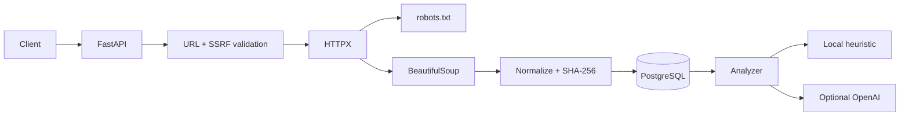

# Smart Web Data Pipeline

[](https://github.com/rokerblym/smart-web-data-pipeline/actions)

Safe, production-style **web extraction and analysis API** using FastAPI, PostgreSQL, SQLAlchemy, BeautifulSoup, HTTPX, Alembic, Docker and optional LLM analysis.

## Architecture



## Features

- safe URL fetching
- SSRF protections
- private/local address blocking
- robots.txt support
- HTML content-type enforcement
- response-size and timeout limits
- BeautifulSoup extraction
- canonical URL + meta description extraction
- normalized text
- SHA-256 deduplication
- PostgreSQL persistence
- optional OpenAI analysis
- local heuristic fallback when no API key is present
- Alembic
- Docker Compose
- pytest
- GitHub Actions CI

## Quick start

```bash
chmod +x setup.sh
./setup.sh
docker compose up --build
```

Swagger: `http://127.0.0.1:8002/docs`

## Example

```bash
curl -X POST http://127.0.0.1:8002/documents/fetch   -H "Content-Type: application/json"   -d '{"url":"https://example.com/"}'
```

Then analyze:

```bash
curl -X POST http://127.0.0.1:8002/documents/<DOCUMENT_ID>/analyze
```

Without an API key the app uses its local analyzer.

To enable optional OpenAI analysis, set in `.env`:

```env
OPENAI_API_KEY=...
OPENAI_MODEL=gpt-5.5
```

Never commit secrets.

## Ethical scraping

Use only on pages you are allowed to access. Respect robots rules, site terms, rate limits, copyright and applicable law.

This repository intentionally excludes CAPTCHA solving, browser fingerprint spoofing, proxy rotation and anti-bot bypass techniques.
